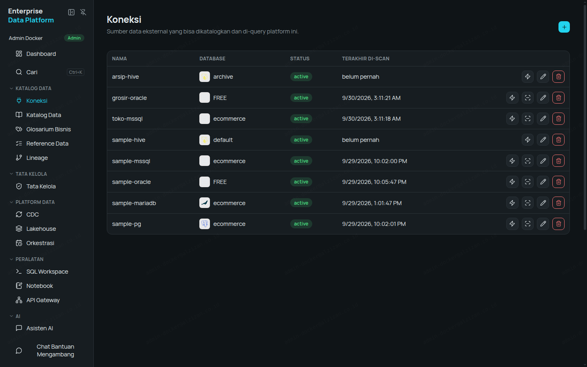
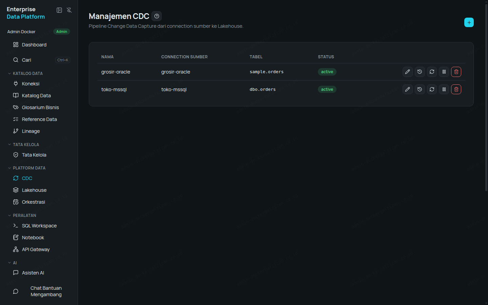
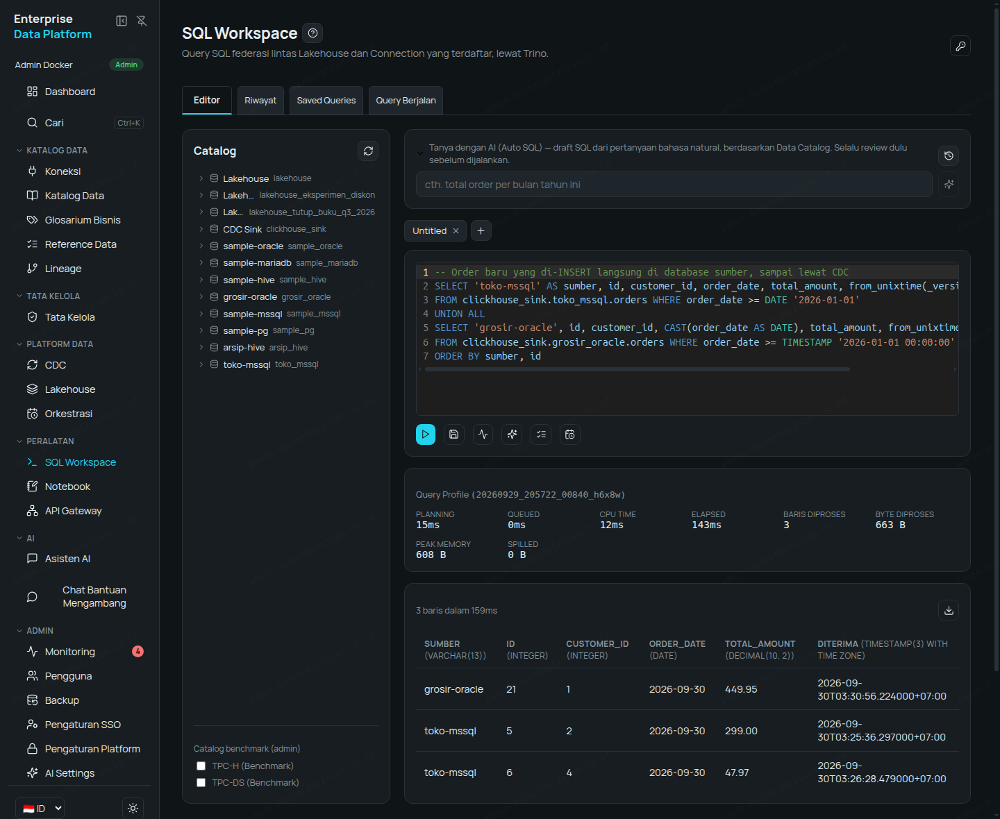
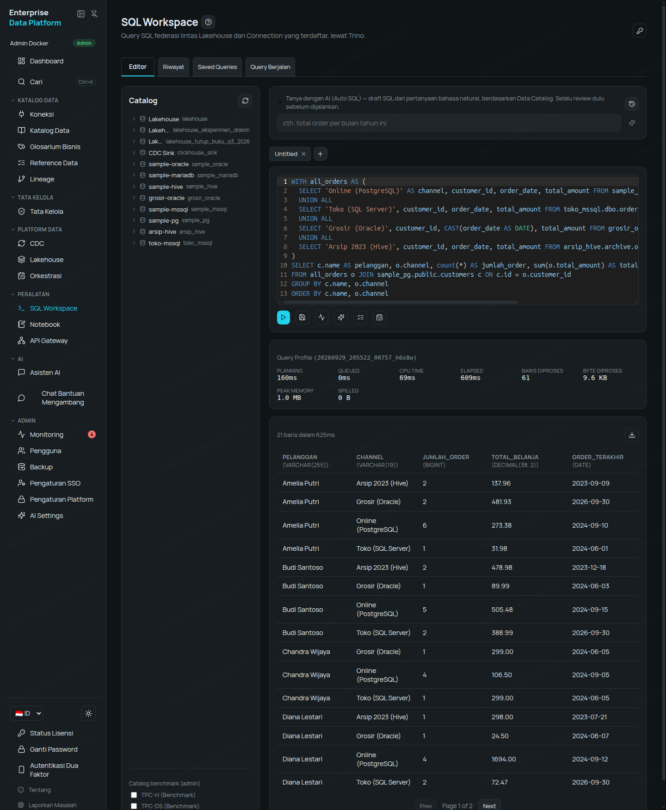
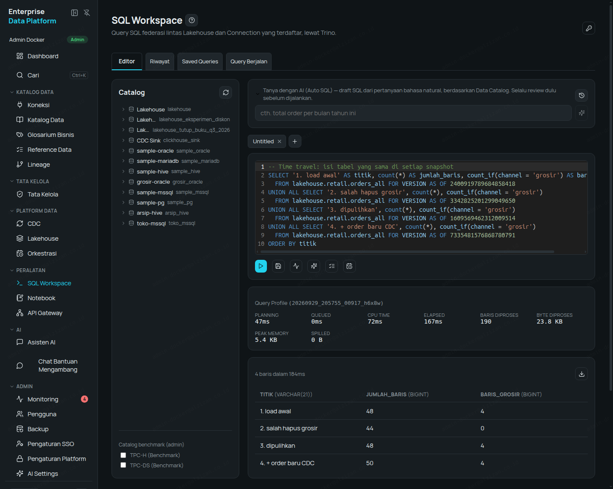
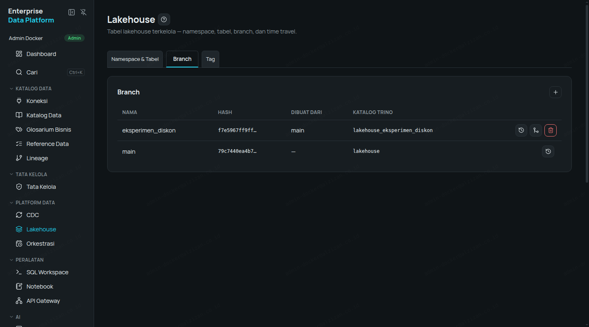
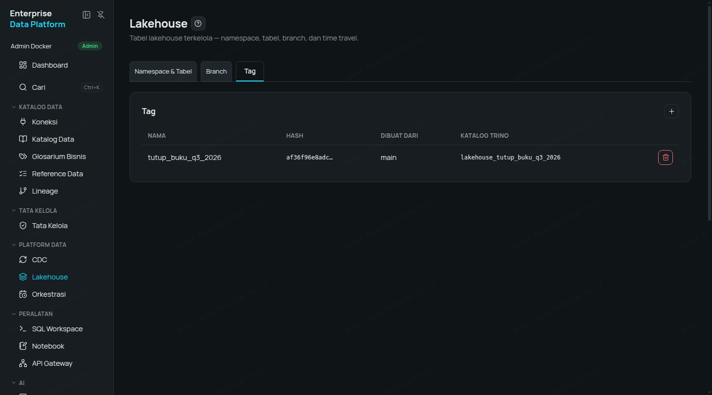
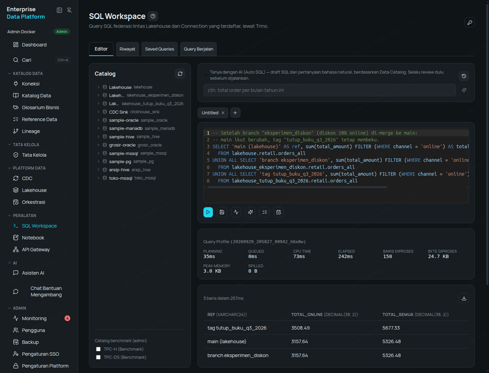

# Walkthrough — Four Data Sources, CDC, Federated Query, and a Lakehouse (Time Travel, Branch, Tag)

**Language:** [Bahasa Indonesia](README.md) · English

Oracle, PostgreSQL, SQL Server, and a Hive data lake are connected to Enterprise Data Platform: data
changes flow automatically via CDC, all four are queried with a single SQL statement, and the result
is stored in a Lakehouse that can be "rewound" (time travel), frozen (tag), and experimented on
without risk (branch). Every number, SQL statement, and screenshot below is a real result, not a
made-up example.

> Some connection, schema, and column names are in Indonesian (e.g. `toko` = store, `grosir` =
> wholesale, `arsip` = archive, `pelanggan` = customer). They are kept as-is so the SQL runs exactly
> as shown.

## Scenario

A fictional retail group has four systems that have never talked to each other:

| System | Technology | Contents | Connection name |
|---|---|---|---|
| Online store | PostgreSQL | Customers + online orders | `sample-pg` |
| Physical-store POS | SQL Server | POS orders | `toko-mssql` |
| Wholesale ERP | Oracle | Wholesale orders | `grosir-oracle` |
| Legacy data lake (Hadoop) | Hive Metastore + S3 | 2023 order archive | `arsip-hive` |

Goal: one view of orders across all channels, the latest changes flowing in automatically (CDC), and
an auditable history (a Lakehouse with time travel, branches, and tags) — without moving the source
databases.

## Part 1 — Sample Data & Connections

Install the sample databases (once):

```bash
curl -fsSL https://get.alzizan.co.id/sample-data | bash -s -- --services postgres,mssql,oracle,s3,hive
```

Open **Connections → New Connection** and fill in the form for each database type. Once saved, click
**Scan** so the tables and columns land in the Data Catalog.

| Connection | Key fields | Scan result |
|---|---|---|
| `sample-pg` (PostgreSQL) | host, port, database `ecommerce`, user/password | 11 tables |
| `toko-mssql` (SQL Server) | host, port, database `ecommerce`, user/password | 4 tables |
| `grosir-oracle` (Oracle) | host, port, **Database** = CDB (`FREE`), **PDB Name** = `FREEPDB1`, application-schema user/password, **CDC Username/Password** = LogMiner user `c##dbzuser` | 3 tables |
| `arsip-hive` (Apache Hive) | Metastore host + port `9083`, database `archive`, Storage Type **S3-compatible** + endpoint, access key, secret key, path-style access | — (Hive doesn't need a scan) |



**Oracle note:** Oracle CDC needs a separate, more privileged account (a common user `C##...` with
LogMiner rights) — standard production practice, rather than reusing the application account.
Database-side prerequisites: `ARCHIVELOG`, supplemental logging, and LogMiner grants.

**SQL Server note:** CDC must be enabled on the source database (`sys.sp_cdc_enable_db` +
`sys.sp_cdc_enable_table`) and SQL Server Agent must be running.

### Archive data in Hive

The archive table is created straight from the **SQL Workspace** — Hive can be written to, not only
read:

```sql
CREATE SCHEMA arsip_hive.archive WITH (location = 's3a://hive-warehouse/archive');

CREATE TABLE arsip_hive.archive.orders_2023 (
  id INTEGER, customer_id INTEGER, product_id INTEGER, order_date DATE,
  status VARCHAR, quantity INTEGER, total_amount DECIMAL(10,2)
) WITH (format = 'PARQUET');

INSERT INTO arsip_hive.archive.orders_2023 VALUES
  (9001,1,1,DATE '2023-03-14','completed',3,47.97),
  (9002,2,3,DATE '2023-05-02','completed',1,299.00),
  (9003,4,4,DATE '2023-07-21','completed',2,298.00),
  (9004,1,2,DATE '2023-09-09','completed',1,89.99),
  (9005,3,1,DATE '2023-11-30','returned',1,15.99),
  (9006,2,2,DATE '2023-12-18','completed',2,179.98);
```

Result: 6 rows stored as Parquet files on S3, read back with `SELECT`.

## Part 2 — CDC, One Table per Database

Open **CDC → New Pipeline**, pick the connection, and list the tables to watch. One table each is
enough: `orders`.

| Pipeline | Table | Connector status | Initial snapshot |
|---|---|---|---|
| `sample-pg` | `public.orders` | RUNNING | 34 rows |
| `toko-mssql` | `dbo.orders` | RUNNING | 4 rows |
| `grosir-oracle` | `sample.orders` | RUNNING | 4 rows |



CDC data can be queried immediately in the catalog `clickhouse_sink.<connection_name>.<table>` —
always the latest version (already deduplicated):

```sql
SELECT id, order_date, total_amount FROM clickhouse_sink.toko_mssql.orders ORDER BY id;
```

### Proof of real-time changes

Insert new rows directly in the source databases (not through the platform):

```sql
-- SQL Server (POS)
INSERT INTO dbo.orders (customer_id, product_id, order_date, status, quantity, total_amount)
VALUES (4, 1, '2026-09-30', 'pending', 3, 47.97);

-- Oracle (wholesale)
INSERT INTO orders (customer_id, product_id, order_date, status, quantity, total_amount)
VALUES (1, 2, DATE '2026-09-30', 'completed', 5, 449.95);
COMMIT;
```

| Source | Time to arrive in `clickhouse_sink` |
|---|---|
| SQL Server | **9 seconds** |
| Oracle (LogMiner) | ±11.5 minutes (inserted 03:19, arrived 03:30 WIB — 130 seconds after the redo log switched) |



**Honest note on Oracle:** Oracle CDC uses LogMiner (free, built into Oracle). Changes are read after
the redo log switches; on a small instance with the default 2×10 MB redo logs and low traffic, the
delay can be several minutes. In production, redo logs sized per recommendations (≥500 MB) and
normal traffic make the delay much shorter. For sub-second latency on Oracle, paid options such as
XStream/GoldenGate remain the choice.

**Why Hive isn't on CDC:** the Hive Metastore only records where files are; it is not a transactional
database — there is no per-row change log to read. The right pattern for Hive: query it directly
(Part 3) or copy it periodically into the Lakehouse with a Scheduled Job (Orchestration).

## Part 3 — One Query Across Four Sources (Federated)

In the **SQL Workspace**, all four systems appear as ordinary catalogs. One query combines them all —
joined to the customers table in PostgreSQL:

```sql
WITH all_orders AS (
  SELECT 'Online (PostgreSQL)' AS channel, customer_id, order_date, total_amount
    FROM sample_pg.public.orders WHERE status <> 'cancelled'
  UNION ALL
  SELECT 'Toko (SQL Server)', customer_id, order_date, total_amount
    FROM toko_mssql.dbo.orders WHERE status <> 'cancelled'
  UNION ALL
  SELECT 'Grosir (Oracle)', customer_id, CAST(order_date AS DATE), total_amount
    FROM grosir_oracle.sample.orders WHERE status <> 'cancelled'
  UNION ALL
  SELECT 'Arsip 2023 (Hive)', customer_id, order_date, total_amount
    FROM arsip_hive.archive.orders_2023 WHERE status = 'completed'
)
SELECT c.name AS pelanggan, o.channel, count(*) AS jumlah_order,
       sum(o.total_amount) AS total_belanja, max(o.order_date) AS order_terakhir
FROM all_orders o JOIN sample_pg.public.customers c ON c.id = o.customer_id
GROUP BY c.name, o.channel
ORDER BY c.name, o.channel;
```

Real result (21 rows, **under 2 seconds**; the figures already include the new orders from CDC in
Part 2), excerpt:

| customer | channel | orders | total_spent | last_order |
|---|---|---|---|---|
| Amelia Putri | Arsip 2023 (Hive) | 2 | 137.96 | 2023-09-09 |
| Amelia Putri | Grosir (Oracle) | 2 | 481.93 | 2026-09-30 |
| Amelia Putri | Online (PostgreSQL) | 6 | 273.38 | 2024-09-10 |
| Amelia Putri | Toko (SQL Server) | 1 | 31.98 | 2024-06-01 |
| Budi Santoso | Arsip 2023 (Hive) | 2 | 478.98 | 2023-12-18 |
| Budi Santoso | Toko (SQL Server) | 2 | 388.99 | 2026-09-30 |
| Diana Lestari | Online (PostgreSQL) | 4 | 1694.00 | 2024-09-12 |



No data is moved first. Access rights and masking still apply per source — users only see the
columns and rows they are allowed to see.

## Part 4 — Lakehouse: Time Travel, Branch, Tag

### 4.1 Bring it together in the Lakehouse

Create the namespace via **Lakehouse → New Namespace** `retail`, then one `CREATE TABLE AS SELECT`
copies the combined four sources into an Iceberg table:

```sql
CREATE TABLE lakehouse.retail.orders_all AS
SELECT 'online' AS channel, id AS order_id, customer_id, order_date, status, total_amount FROM sample_pg.public.orders
UNION ALL SELECT 'toko', id, customer_id, order_date, status, total_amount FROM toko_mssql.dbo.orders
UNION ALL SELECT 'grosir', id, customer_id, CAST(order_date AS DATE), status, total_amount FROM grosir_oracle.sample.orders
UNION ALL SELECT 'arsip_2023', id, customer_id, order_date, status, total_amount FROM arsip_hive.archive.orders_2023;
```

Result: **48 rows** (online 34, toko 4, grosir 4, arsip_2023 6).

### 4.2 Time Travel — recover deleted data

Someone accidentally deletes all wholesale orders:

```sql
DELETE FROM lakehouse.retail.orders_all WHERE channel = 'grosir';
```

Every change is recorded as a snapshot:

```sql
SELECT snapshot_id, committed_at, operation
FROM lakehouse.retail."orders_all$snapshots" ORDER BY committed_at;
```

Look at the state **before** the deletion, then restore only the missing rows:

```sql
SELECT channel, count(*) FROM lakehouse.retail.orders_all
FOR VERSION AS OF 2400919789684858418 GROUP BY channel;   -- grosir still 4

INSERT INTO lakehouse.retail.orders_all
SELECT * FROM lakehouse.retail.orders_all FOR VERSION AS OF 2400919789684858418
WHERE channel = 'grosir';
```

Then add the new POS orders from CDC (Part 2):

```sql
INSERT INTO lakehouse.retail.orders_all
SELECT 'toko', CAST(id AS decimal(10,0)), CAST(customer_id AS decimal(10,0)),
       order_date, from_utf8(status), total_amount
FROM clickhouse_sink.toko_mssql.orders WHERE id > 4;
```

Real history:

| Snapshot | Time (WIB) | Operation | Row count at that point |
|---|---|---|---|
| `2400919789684858418` | 03:19:04 | append (initial load) | 48 |
| `3342825201299049650` | 03:27:26 | delete (accidental) | 44 |
| `1609569462312009514` | 03:27:42 | append (recovery) | 48 |
| `7335481576868780791` | 03:27:43 | append (new CDC orders) | 50 |

Querying by time works too:
`... FOR TIMESTAMP AS OF TIMESTAMP '2026-09-30 03:20:00 Asia/Jakarta'` → 48 rows.



**Tip:** when copying from `clickhouse_sink` into the Lakehouse, text columns need `from_utf8(...)`
and numeric types must match the target table.

### 4.3 Tag — freeze the period-close state

**Lakehouse → Tags → New Tag**: `tutup_buku_q3_2026` ("Q3 2026 period close") from `main`. The tag can
be queried right away as the catalog `lakehouse_tutup_buku_q3_2026`, and it **cannot be changed**:

```sql
INSERT INTO lakehouse_tutup_buku_q3_2026.retail.orders_all
SELECT * FROM lakehouse.retail.orders_all LIMIT 1;
-- Rejected: "You can only mutate tables/views when using a branch without a hash or timestamp."
```

### 4.4 Branch — experiment without touching the main data

**Lakehouse → Branches → New Branch**: `eksperimen_diskon` ("discount experiment") from `main`.
Simulate a 10% discount for the online channel, on the branch only:

```sql
UPDATE lakehouse_eksperimen_diskon.retail.orders_all
SET total_amount = total_amount * 0.9 WHERE channel = 'online';   -- 34 rows
```

Compare the three refs:

| Catalog | Online total | All-channel total |
|---|---|---|
| `lakehouse` (main) | 3508.49 | 5677.33 |
| `lakehouse_eksperimen_diskon` (branch) | **3157.64** | 5326.48 |
| `lakehouse_tutup_buku_q3_2026` (tag) | 3508.49 | 5677.33 |

The experiment is approved → **Merge** the branch into `main` (Merge button on the Branches tab). Real
result: `was_applied: true`, no conflicts. After the merge:

| Catalog | Online total |
|---|---|
| `lakehouse` (main) | 3157.64 — changed as well |
| `lakehouse_tutup_buku_q3_2026` (tag) | 3508.49 — **unchanged**, the period-close state is preserved |







## Part 5 — Nessie vs Hive Metastore

Both are **metadata catalogs**: the place that records "table X exists, here is its schema, its data
files are here". The actual data remains files (Parquet/ORC) on object storage/HDFS. The difference is
*what gets recorded* and *how changes are tracked*.

| Aspect | Hive Metastore | Nessie (the platform's Lakehouse catalog) |
|---|---|---|
| Origin | Hadoop ecosystem, the de-facto standard since the 2010s | A modern project for Apache Iceberg |
| Table format | Hive tables (directories of files) | Apache Iceberg (snapshots + manifests) |
| What is recorded | The *current* table/partition location | A pointer to Iceberg metadata per commit, like Git |
| Change history | None — current state only | Every change = a hashed commit you can trace |
| Time travel | No | Yes — `FOR VERSION AS OF` / `FOR TIMESTAMP AS OF` |
| Branches & tags | No | Yes — branches for experiments, tags for freezing |
| Multi-table transactions | No | Yes — one commit can cover many tables |
| Schema changes | Limited (add columns; rename/drop is risky) | Full (add, rename, drop, reorder) |
| Row UPDATE/DELETE | Limited (requires special ACID tables) | Supported (`UPDATE`, `DELETE`, `MERGE`) |
| Protocol | Thrift | REST API |
| Best for | Existing Hadoop data lakes used by many legacy tools | New lakehouses that need auditing, versions, and safe experiments |

**When to use which:**

- **Hive Metastore** → connect it as a Connection when the company already has a Hadoop/Hive data
  lake. Its data can be queried and joined with other sources right away (Part 3), with no migration.
- **Nessie** → used by the platform's built-in Lakehouse. New data (CDC output, transformation
  results, archives) should land here to get time travel, branches, and tags (Part 4).
- **Common migration pattern:** keep Hive running for legacy tools, then copy the actively used
  tables into the Lakehouse with one `CREATE TABLE ... AS SELECT` — exactly as in Part 4.1.

## Summary

- 4 different databases connected and scanned within minutes, without moving any data.
- CDC for Oracle, PostgreSQL, and SQL Server runs from a single form; SQL Server changes arrive within
  9 seconds.
- One SQL query combines all four sources in under 2 seconds.
- The Lakehouse keeps the full history: recover an accidental delete with time travel, freeze a
  period close with a tag, test changes on a branch and then merge.

## Try It Yourself

- Free trial, no sales call: https://alzizan.co.id/register
- Want to see it with your team's use case? Request a demo, or a free in-house *Big Data & AI Tech Update* session at your office: sales@alzizan.co.id
- Demo videos: https://www.youtube.com/@AlzizanDigitalSolutions

---

The content of this repository is licensed under [CC BY 4.0](LICENSE). © PT Alzizan Digital Solutions.
